# Rivet Files

[](https://github.com/ulinaaron/rivet-files/actions/workflows/ci.yml)
[](https://github.com/ulinaaron/rivet-files/releases/latest)
[](#-license)
[](#-install)
[](https://github.com/emilk/egui)


A Linux file manager in the same vein as Dolphin, Nemo, Thunar and Caja — written in Rust. Does not use GTK or Qt.

Rivet is powerful all the while being minimal. Make it your own — bloat the interface with every button and panel imaginable. Or strip it back and keep just a few controls visible.

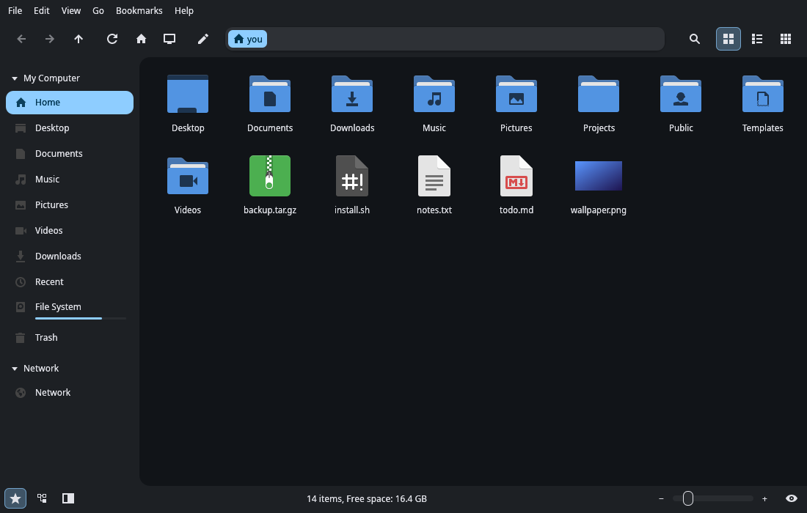

<table>
  <tr>
    <td>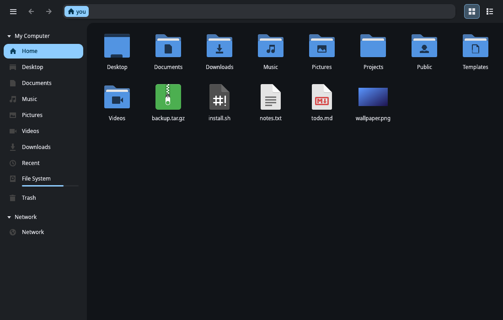</td>
    <td>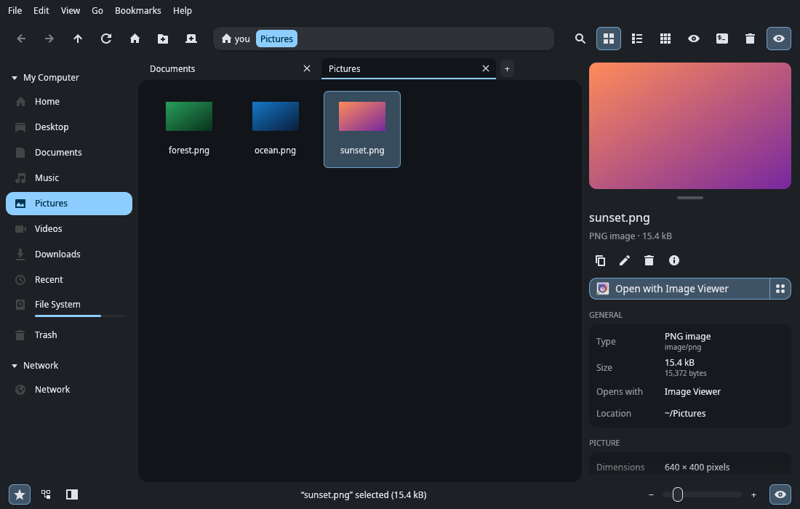</td>
  </tr>
  <tr>
    <td align="center">Minimal — menu button, back / forward, location bar, two views</td>
    <td align="center">Bloated — every bar, button and panel</td>
  </tr>
</table>

## ✨ Features

**Getting around**
- 🗂️ **Icon, list and compact views** with tabs and a clickable path bar that suggests folders as you type
- 🧭 **Sidebar** — places, bookmarks, drives with usage bars, network, or a folder tree, on the left or right
- 🧪 **Filters** — show a folder with only pictures, recent files or names you choose; global, per folder, or for a folder and everything below it
- 🔦 **Quick Open** — Ctrl+P, type a few letters of any folder, press Enter and you're there
- ⚙️ **Quick Actions** — Ctrl+Shift+P, every command and view option in one searchable list
- 🔍 **Instant filter** as you type, plus search through subfolders
- 🌐 **Network** — find servers, open SMB shares, log in, or connect to any address

**Working with files**
- 📋 **Everything you expect** — copy, cut, paste, drag and drop, rename, Trash with restore
- ↩️ **Undo and redo** — copies, moves, renames, Trash, new items, compress and extract
- ✏️ **Bulk Rename** — insert, date / time, numbering, remove, search & replace and case changes, with a live preview
- 🔄 **Convert and resize** — pictures, videos and audio to another format, one file or many; resize pictures (uses ffmpeg)
- 🗜️ **Compress and extract** — zip, tar.gz, tar.xz, tar.zst and 7z
- 🚀 **Open With** — pick any app from a searchable list, or set a new default

**Seeing inside**
- 🖼️ **Picture thumbnails** and your system icon theme
- 👀 **Peek panel** — big previews, videos that play right there, code colored by your theme, and full file details, on either side
- 🔎 **Preview** — a full-window light box (Space); ← → step through the folder's pictures, videos and text

**Making it yours**
- 🎨 **Follows your colors** — Matugen, Noctalia, Dux Shell, and GTK themes, live, no restart
- 💜 **Built-in icon set** recolored from your palette (primary, secondary or tertiary)
- 🧰 **Your layout** — custom toolbar at the top or bottom, status bar top, bottom or off, fonts (and a monospace font for text previews), text size, hideable menu bar
- 🖥️ **Terminal mode** — the same window dressed like a terminal program: monospace text, Nerd Font icons, plain boxes
- 🧩 **Modules** — switch Bulk Rename or Convert & Resize off if you don't use them
- 🧘 **Zen mode** — just your files, edge to edge; the toolbar, sidebar and Peek slide in when you reach for their edge (F12)
- 🪟 **Title bar your way** — your desktop's, or Rivet's own with window buttons

**Under the hood**
- ⚡ **Fast** — 100,000 files open in under 0.4 s, and an idle Rivet uses no CPU
- 🦀 **Light** — one 14 MB program (a 6 MB AppImage download); video previews and conversion use ffmpeg when it's installed

## 🎨 Follows your colors

Change your wallpaper or scheme and Rivet restyles itself within a second.

<table>
  <tr>
    <td>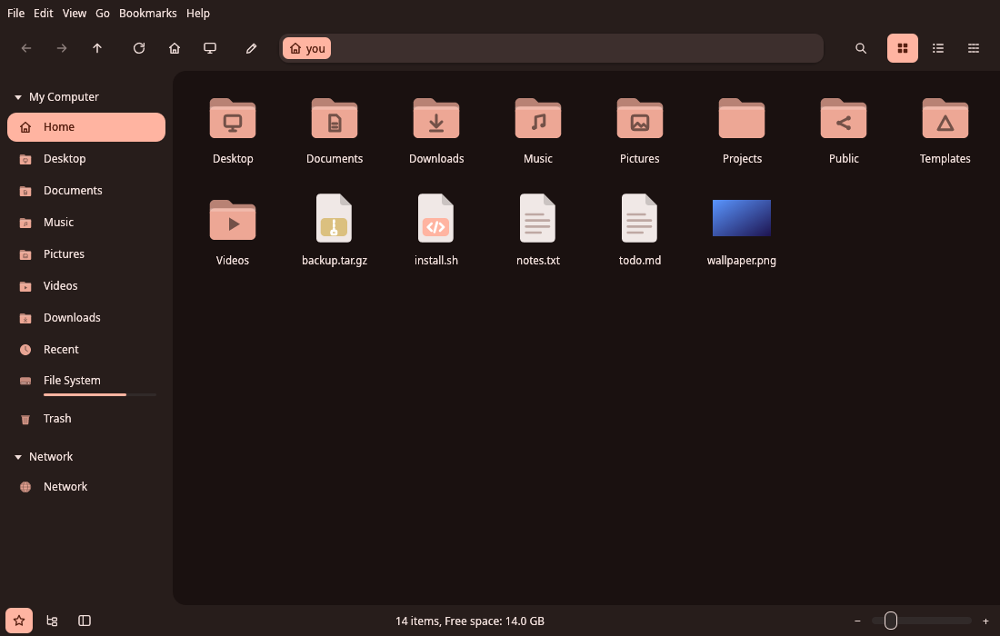</td>
    <td>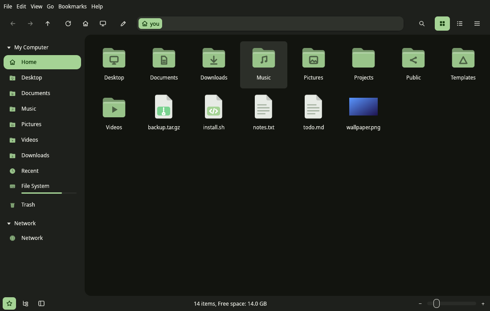</td>
  </tr>
  <tr>
    <td>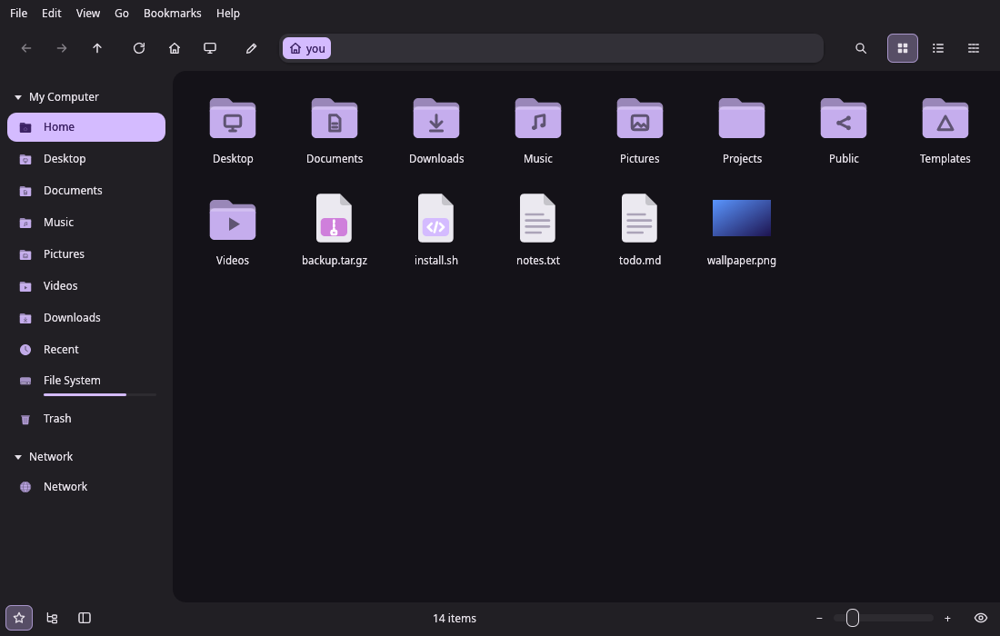</td>
    <td>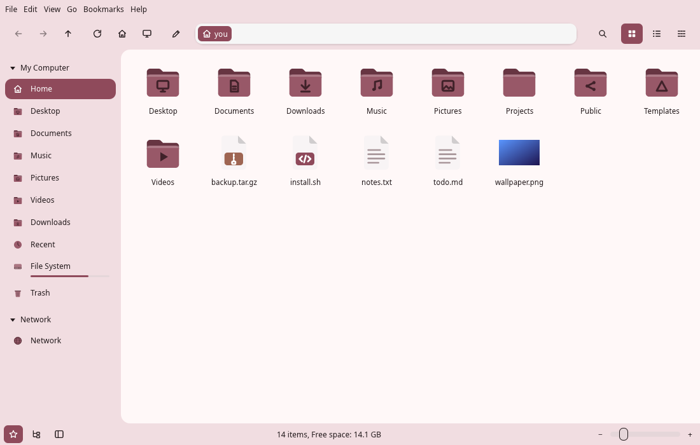</td>
  </tr>
</table>

<table>
  <tr>
    <td>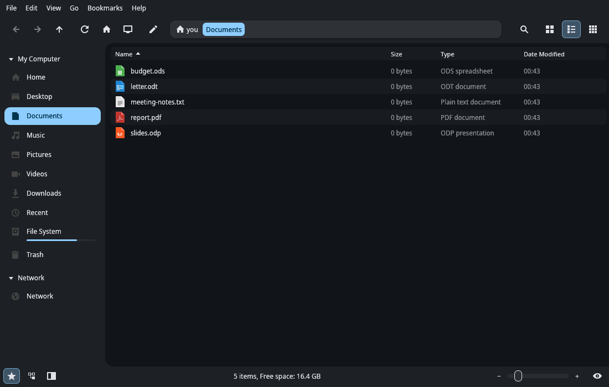</td>
    <td>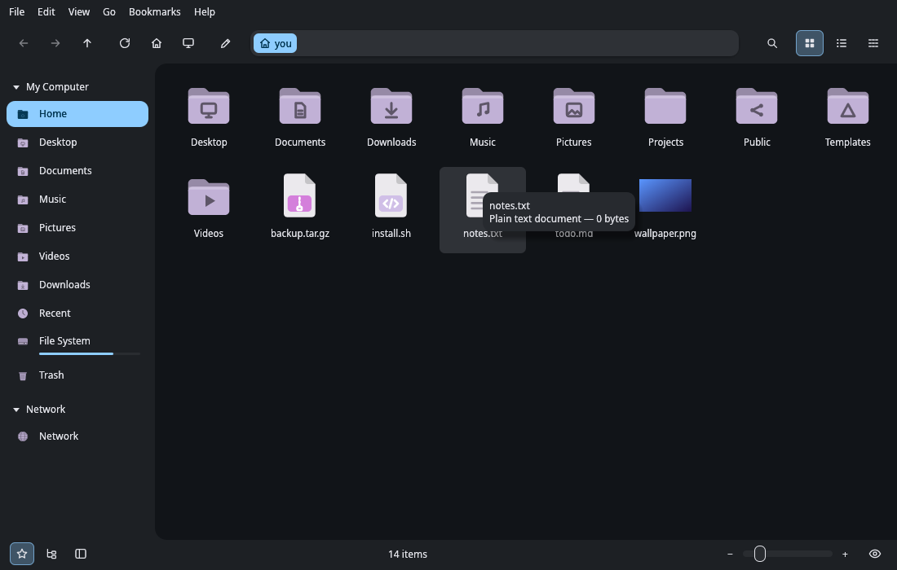</td>
    <td>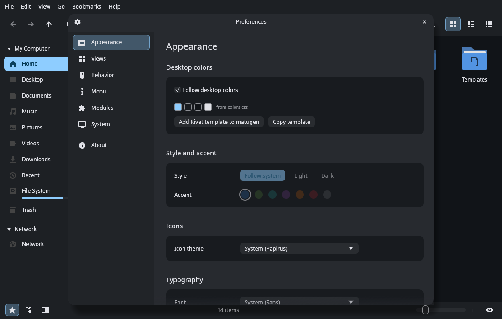</td>
  </tr>
  <tr>
    <td align="center">List view</td>
    <td align="center">Built-in icons</td>
    <td align="center">Preferences</td>
  </tr>
</table>

### 👀 Peek

Select something and the Peek panel (F11) shows it big: pictures, videos that play right in the panel,
music covers, and text with syntax highlighting in your theme's colors — plus everything about the file.
Drag the grip under the preview to make it taller or shorter.

<table>
  <tr>
    <td>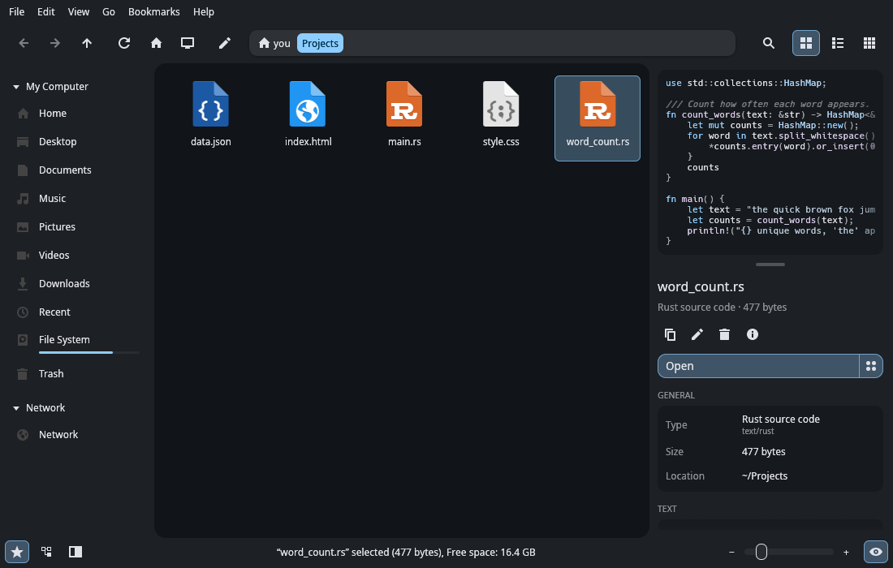</td>
    <td>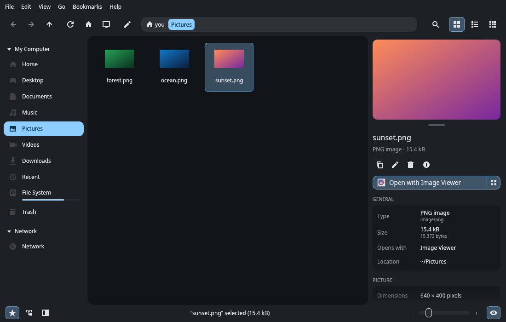</td>
  </tr>
  <tr>
    <td align="center">Code, colored by your theme</td>
    <td align="center">Pictures and details</td>
  </tr>
</table>

### 🧰 Tools

<table>
  <tr>
    <td>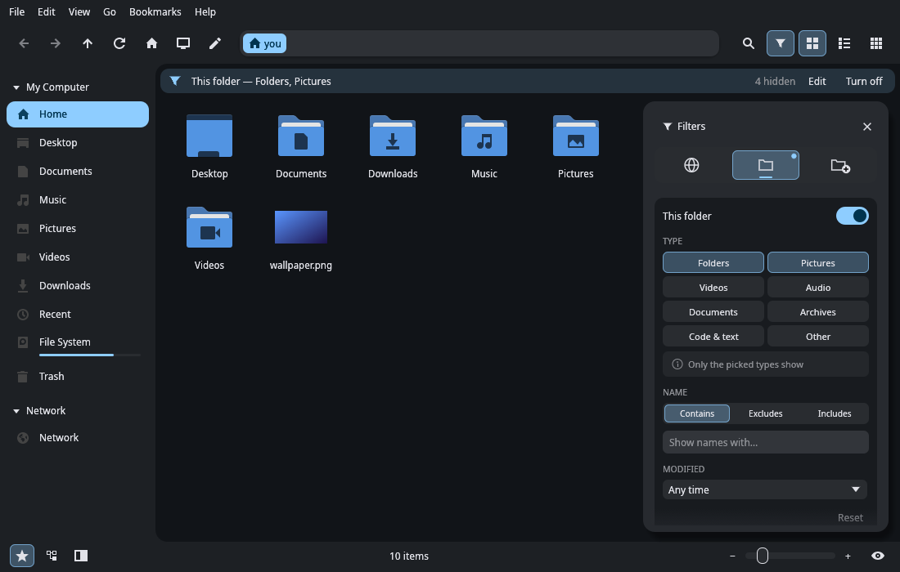</td>
    <td>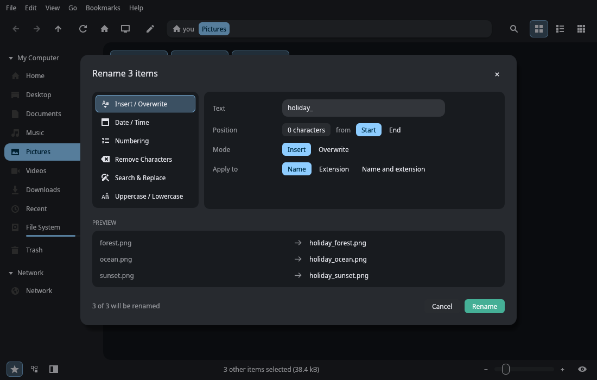</td>
  </tr>
  <tr>
    <td align="center">Filters — this folder shows only folders and pictures</td>
    <td align="center">Bulk Rename — every new name previewed first</td>
  </tr>
</table>

### 🧘 Zen mode, Quick Open and Quick Actions

Press F12 and the bars step aside so your files get the whole window. Reach for an edge and the
toolbar, sidebar or Peek slides in; move away and it's gone again. Pair it with Quick Open
(Ctrl+P): type a few letters of any folder and press Enter. Everything else is in Quick Actions
(Ctrl+Shift+P): type "tree", "theme dark" or "zen" and press Enter.

<table>
  <tr>
    <td>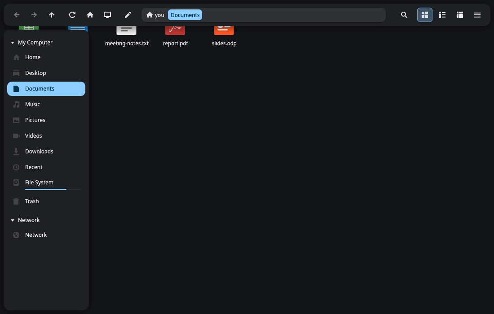</td>
    <td>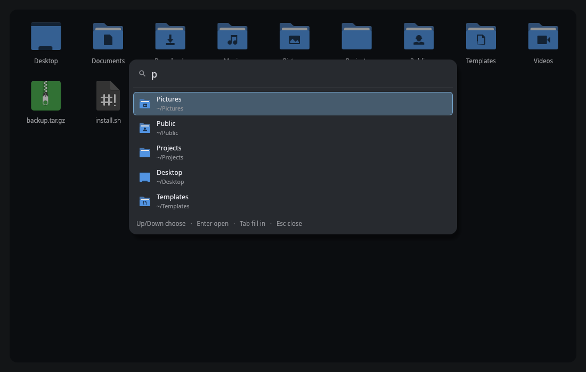</td>
  </tr>
</table>

### 🖥️ Terminal mode

A GUI that feels like a TUI. Press F7 (or set Mode to Terminal in Preferences → Appearance) and everything turns monospace, the icons become Nerd Font glyphs colored by kind, and the
panels become plain boxes with their titles in the border. The layout and every feature stay the
same. It uses your monospace font (Preferences → Appearance → Typography), and any installed Nerd
Font for the icons.

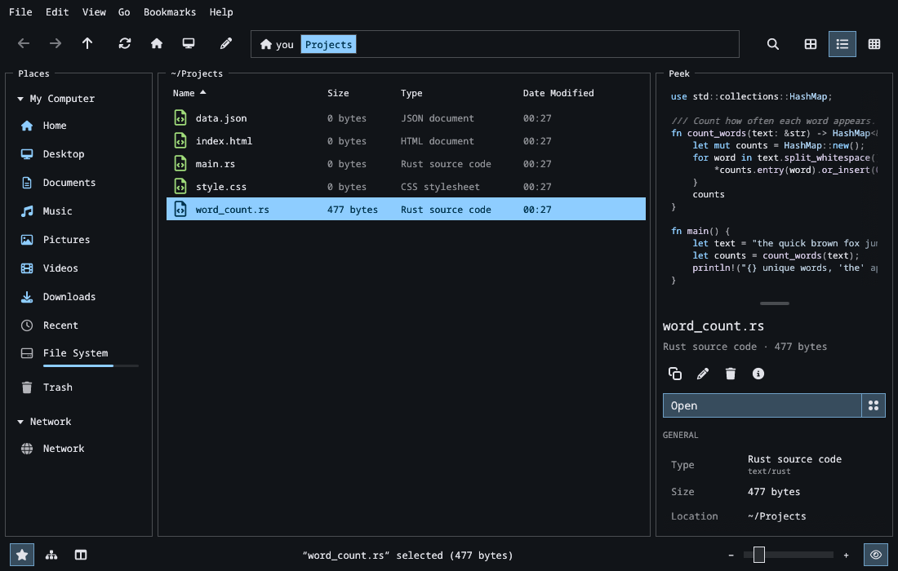

## 📦 Install

Grab the latest from the [Releases page](https://github.com/ulinaaron/rivet-files/releases):

- **AppImage** — one file, nothing else to install: `chmod +x Rivet_Files-*.AppImage` and run it.
  It includes the keyboard libraries below and runs on Ubuntu 22.04, Debian 12, and newer.
  Preferences → System → *Add Rivet to the app launcher* puts it in your menus.
- **Archive** — unpack `rivet-files-*-linux.tar.gz` and run `./install.sh`
  (add `--default` to make Rivet your default file manager). Same glibc baseline as the AppImage.
  Install the libraries below if the desktop does not already have them.
- **From source** — `utilities/rivet-dev install` (builds a release and adds Rivet to your app launcher)
- **Flatpak** — a `.flatpak` bundle is attached to GitHub releases once CI has built it.
  It is not on Flathub until that submission is done; the manifest and the steps are in [packaging/README.md](packaging/README.md).
  Inside the sandbox, home, other disks, Trash and `~/.config` theme files are the real ones. Host `/usr` and `/etc` are under **Host system files** (`/run/host`).
- **Arch Linux** — PKGBUILDs for `rivet-files-bin` (the release tarball) and `rivet-files` (built from the git tag) are in `packaging/aur`. They are not in the AUR until published; see [packaging/README.md](packaging/README.md).

### Libraries the window needs

Rivet talks to X11 or Wayland directly. It does not use GTK or Qt. A normal desktop already has the display libraries (`libX11`, `libwayland-client`, `libwayland-cursor`, OpenGL). What a minimal install often lacks is the keyboard library loaded at startup: `libxkbcommon` on Wayland, and `libxkbcommon-x11` plus `libxcb-xkb` on X11. If one is missing, Rivet prints the install command instead of crashing. The AppImage already carries those three.

| Distro | Install |
| --- | --- |
| Debian, Ubuntu | `sudo apt install libxkbcommon0 libxkbcommon-x11-0 libxcb-xkb1` |
| Fedora, RHEL | `sudo dnf install libxkbcommon libxkbcommon-x11` |
| Arch Linux | `sudo pacman -S libxkbcommon` |
| openSUSE | `sudo zypper install libxkbcommon0 libxkbcommon-x11-0` |

## ⌨️ Handy shortcuts

| Keys | Action |
| --- | --- |
| `Ctrl+L` · `Tab` | Type a location · complete the suggested folder |
| `Ctrl+F` or just type | Filter this folder |
| `Ctrl+T` / `Ctrl+W` | New / close tab |
| `Ctrl+H` | Show hidden files |
| `Ctrl+1` `2` `3` | Icon / list / compact view |
| `F2` · `Delete` | Rename (Bulk Rename with several selected) · move to Trash |
| `Ctrl+M` | Show or hide the menu bar |
| `Ctrl+P` · `Ctrl+Shift+P` | Quick Open: go to any folder · Quick Actions: any command or option |
| `F7` · `F8` · `F9` · `F11` · `F12` | Terminal mode · status bar · sidebar · Peek panel · Zen mode |
| `Ctrl+Shift+F` | Filters |
| `Space` · `←` `→` · `Return` | Preview the selection · previous / next file · open it |
| `Ctrl+Z` / `Ctrl+Shift+Z` | Undo / redo |
| `Ctrl+,` | Preferences |
| `F1` | All shortcuts |

Prefer Vim keys? Turn them on in Preferences → Behavior: `h` `j` `k` `l` move (in the list view
`h` `l` go to the parent folder and open), `-` parent folder, `o` open, `gg` `G` first / last, `H` `L` back / forward, `yy` `dd` `p` copy / cut / paste, `/` search,
`:` Quick Actions.

## ⚡ Performance

**100,000 files** — one folder of empty files on btrfs, a fresh launch each time, median of five runs
(`utilities/rivet-dev bench`). *First window* is when the compositor lists the window,
*settled* is when the process has used no CPU for 500 ms, *PSS* is memory, *CPU* is total
processor time up to that point — the same method as [Flea's benchmark](https://github.com/thisisgm/flea#performance).

| | First window | Settled | PSS | CPU |
| --- | ---: | ---: | ---: | ---: |
| **Rivet** 0.1.1, list | 385 ms | 0.42 s | 76.8 MiB | 1.05 s |
| **Rivet** 0.1.1, icons | 385 ms | 0.43 s | 76.9 MiB | 1.05 s |

For context, Flea publishes these figures from **their own machine** with the same method
(we have not run these apps here, so treat it as a rough comparison):

| | First window | Settled | PSS | CPU |
| --- | ---: | ---: | ---: | ---: |
| Flea 0.4.0 | 319 ms | 0.75 s | 63.0 MiB | 0.53 s |
| Dolphin 26.08 | 791 ms | 5.25 s | 235.1 MiB | 8.18 s |
| Nautilus 51.1 | 931 ms | 20.33 s | 337.2 MiB | 21.67 s |
| Nemo 6.6 | 928 ms | 22.61 s | 479.3 MiB | 26.03 s |
| PCManFM 1.4 | 479 ms | 35.29 s | 124.4 MiB | 24.25 s |
| Thunar 4.20 | 601 ms | 19.71 s | 394.9 MiB | 19.82 s |

Rivet reads big folders on all CPU cores, so its CPU total is higher than its wall-clock time.
When idle it uses no CPU at all: a small background watcher wakes the window only when a
folder, your colors or your drives actually change.

<details>
<summary><b>More numbers</b></summary>

Release build on Fedora, Wayland, NVMe SSD:

| | |
| --- | --- |
| Drawing a frame (100,000 items) | ~2 ms |
| Reading 2,092 / 100,000 items | ~19 ms / ~156 ms |
| Sorting 100,000 items by name / type | ~17 ms / ~27 ms |
| Indexing icon themes (once) | ~26 ms |
| Binary size (stripped) | ~14 MB (AppImage ~6 MB) |

Reproduce with `rivet --bench [FOLDER…]`, `RIVET_FRAME_STATS=1 rivet --screenshot out.png`
and `utilities/rivet-dev bench`.

</details>

## 🗺️ Roadmap

- Freedesktop file picker integration
- Tagging and pinning files

## 🛠️ For developers

<details>
<summary><b>Build, run and options</b></summary>

```sh
cargo build --release
./target/release/rivet [FOLDER]
```

`rivet [FOLDER]` opens that folder (`~` and `file://` URLs work). `rivet --help` lists the same options:

| Option | |
| --- | --- |
| `-h`, `--help` | Show this help and exit |
| `-V`, `--version` | Print the version and exit |
| `--home` | Open the home folder |
| `--view icons\|list\|compact` | Starting view |
| `--tree` | Show the sidebar as a folder tree |
| `--hide-menubar` | Start with the menu bar hidden |
| `--decorations` | Use the desktop's title bar |
| `--no-decorations`, `--csd` | Use Rivet's own title bar |
| `--screenshot FILE.png` | Save a picture of the window and exit |
| `--measure SECS` | Open a window and exit after SECS seconds (default 15) |
| `--bench [FOLDER...]` | Time folder reads without a window, then exit |
| `--export-icons [DIR]` | Write the logo icons and exit (default `data/icons`) |
| `--install-desktop-entry` | Add Rivet to the app launcher and exit |

A global `rivet` command that always runs your latest build: `utilities/rivet-dev link` (system-wide, asks for
your password) or `utilities/rivet-dev link --user` (`~/.local/bin`). Preferences → System has the same buttons.

</details>

<details>
<summary><b>Where the colors come from</b></summary>

In order of priority:

1. `~/.config/rivet/colors.css` (`@define-color name #rrggbb;`)
2. whichever is newer: your matugen outputs (learned by lining each template in
   `~/.config/matugen/config.toml` up with its output) or generated GTK color files
   (`~/.config/gtk-{3,4}.0/gtk.css` / `colors.css`, following `@import`)
3. the defaults of the installed GTK theme

Preferences → *Add Rivet template to matugen* registers a dedicated template if you prefer one.

</details>

<details>
<summary><b>Screenshots, logo and releases</b></summary>

- **All developer tasks** run through one command: `utilities/rivet-dev help` lists them (the scripts behind it live in `utilities/lib/`).
- **Screenshots** come from a throwaway sample home folder: `utilities/rivet-dev screenshots`
- **Logo** master is `data/rivet-files.svg`; regenerate the PNG set with
  `rivet --export-icons data/icons` and copy the 512 px one to `docs/logo.png`
- **AppImage**: `utilities/rivet-dev appimage` (needs `squashfs-tools`). It links for glibc 2.31 and bundles the keyboard libraries, so the one file runs on Ubuntu 22.04 and Debian 12.
- **Release**: keep notes under `## Unreleased` in `CHANGELOG.md`. `utilities/rivet-dev bump` (patch, or `minor` / `major` / `X.Y.Z`)
  sets the version, turns that section into the release's (or writes one from the commits) and commits; then `utilities/rivet-dev release --publish`. Plain `release` only builds and tags on your computer; `push` only sends your commits to GitHub, with no release. The release binary is linked with Zig against glibc 2.31 (not the build machine's libc). CI rejects an ELF that needs a GLIBC symbol newer than 2.35.

</details>

## 📄 License

[MIT](LICENSE-MIT) or [Apache-2.0](LICENSE-APACHE), at your option.
